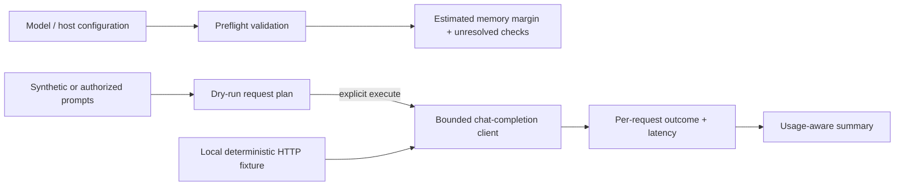

> **Proprietary - All Rights Reserved.** Licensed to Sandeep Grover. No reuse, copying, modification, or distribution without prior written permission. See LICENSE.

# One-host LLM preflight and benchmark

A runnable, standard-library Python example for one-host inference planning and bounded measurement of an existing OpenAI-compatible chat endpoint.

**Evidence boundary:** this repository validates supplied configuration and exercises HTTP client/report behavior against a deterministic local fixture. No GPU was provisioned, no model weights were loaded, and no paid endpoint was used to build or test it. Local fixture timings are not model or GPU throughput. This is not a claim of a prior client deployment.

## Architecture



## Setup and local checks

Python 3.10 or newer. Runtime requires no third-party packages.

```bash
python main.py preflight examples/synthetic_config.json
python main.py benchmark --model synthetic-demo --prompts examples/prompts.json --dry-run
python -m unittest discover -s tests -v
# Optional, if pytest is installed:
python -m pytest -q
```

The default benchmark mode is a dry run: it does not read an API key or contact a server. The sample configuration is explicitly fictitious. Its estimated per-GPU margin is 4.6 GiB, but status remains `needs_runtime_verification`.

## Using an already authorized endpoint

The base URL includes `/v1`; the client appends `/chat/completions`. To measure an existing local service:

```bash
python main.py benchmark --base-url http://127.0.0.1:8000/v1 \
  --model YOUR_SERVED_MODEL_NAME --prompts examples/prompts.json \
  --concurrency 2 --max-tokens 32 --execute
```

Use an SSH tunnel for a remote host's plain HTTP service. Direct remote access requires HTTPS and `--allow-remote`. If authentication is needed, supply the *name* of an existing environment variable with `--api-key-env`; do not put credentials in command arguments, files or logs. `--execute` can cause inference charges on a paid endpoint; no such calls are part of these tests. HTTP redirects are rejected to avoid forwarding credentials. Environment proxies are not used.

## Preflight boundaries

Checks include an immutable 40-character model revision, selected runtime/version, positive finite GPU resources, tensor parallelism no larger than the one host's GPU count, and a declared memory budget. The estimate subtracts evenly sharded weights, supplied KV-cache allocation and supplied overhead from the selected fraction of GPU memory.

That arithmetic is **not** an architecture-aware fit guarantee. It cannot verify kernel support, GPU topology, weight replication, quantization compatibility, driver versions, licenses or real KV-cache growth. Those require inspecting the selected model/runtime and testing the real host. Configuration validity never becomes `deployment_verified=true`.

## Benchmark definitions

- Non-streaming chat-completion requests with bounded request count, concurrency, output tokens and timeout.
- Per-request client latency; nearest-rank p50/p95 for successful requests only. Failed requests remain in the report.
- Aggregate successful output tokens divided by the entire measured batch wall time, including failure time. This is not per-user decode speed.
- If successful responses omit token usage, throughput is `null`, rather than an invented zero or an inferred token count.
- Server-reported token usage is not independently tokenized. The model's semantic accuracy is not evaluated.
- Time to first token, inter-token latency, GPU memory, startup and warm-up are not measured. Run warm-up separately if required and identify the measurement window.
- Small request counts provide coarse tail-latency estimates. Preserve workload, checkpoint and hardware before comparing runs.
- Prompts, response text, API keys and server error bodies are omitted from reports; response hashes and request indices permit limited correlation. Use only public, synthetic or authorized input.

## What tests exercise

Real loopback HTTP requests validate payload/path construction, token accounting, missing usage, malformed responses, HTTP failures, redirect rejection and content-free logs. Deterministic arithmetic verifies wall-time throughput and percentile definitions. Separate tests cover invalid budgets, mutable revisions, excessive GPU parallelism, explicit execution, missing credentials and request bounds.

There is no automatic provisioning, runtime launcher, model download or cloud purchase. The client can be reused after an authorized deployment exists; it is not a replacement for that deployment's validation.

## Primary references

Checked 24 October 2026. Runtime behavior must be rechecked against the pinned version used in a real pilot.

- [vLLM online serving](https://docs.vllm.ai/en/latest/serving/online_serving/)
- [vLLM memory, batching and parallelism trade-offs](https://docs.vllm.ai/en/latest/configuration/optimization/)
- [SGLang chat request tutorial](https://docs.sglang.io/docs/basic_usage/send_request)

The demo uses their shared chat-completion interface shape. It does not assume that their launch flags or supported model architectures are interchangeable.
